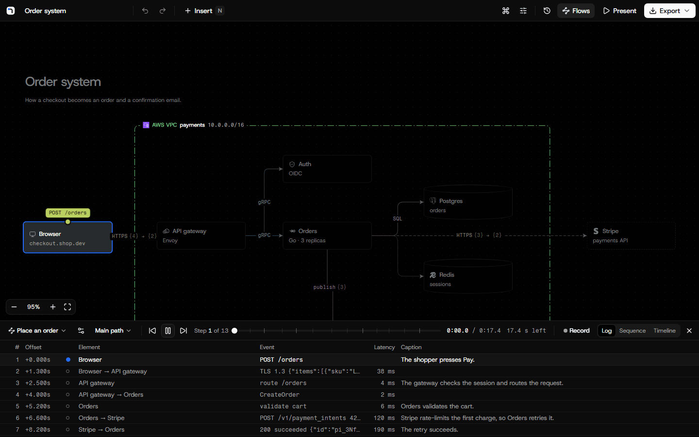

# Diagrams

Architecture diagrams and user flows that look finished and move. Free, with no account. Your diagrams stay on your
computer.

**Try it at [draw.thias.dev](https://draw.thias.dev).**



## Features

<!-- features:start -->

- **Play a request through it.** Record a path, add captions, and play it with a camera that follows. Read it as a log or a sequence diagram, with fan-out and alternate paths.
- **Replay a real trace.** Import an OpenTelemetry, Jaeger or Zipkin trace, and watch the request move with each operation, latency and status.
- **See where sensitive data goes.** Mark body fields as personal data or secrets, and see which connections carry them across a trust boundary.
- **Let an AI agent draw it.** In the desktop app, Claude Code and other MCP clients draw, animate and check diagrams while you watch, also from Terraform, docker-compose or Kubernetes files.
- **Share it anywhere.** Present in full screen, export PNG, SVG, MP4, WebM or GIF, or a web page that plays its flows. Copy an image, or a link that carries the whole diagram.
- **Keep diagrams with your code.** A diagram is a JSON file that you review and diff. A GitHub Action shows each diagram before and after in a pull request.

Also:

- **Templates.** C4, RAG, an agent with MCP tools, an OpenID Connect sign-in, webhooks, a deploy pipeline and more, ready to play.
- **Node kinds.** Services, data stores, queues, clients and more, each with its own outline.
- **Real icons.** Official AWS, Azure, Google Cloud and Kubernetes icons, and 220 software logos.
- **Boundaries.** Cloud, network and cluster boundaries, or your own groups, such as a team.
- **Colours and metrics.** Colour nodes by kind or by group, and add numbers or meters.
- **Moving connections.** Dots, comets, dashes or pulses that flow along a connection.
- **Details on hover.** An owner, a description and links on a node, shown on hover in Present.
- **Request and response bodies.** The JSON fields of a connection, shown in the log as a flow plays.
- **Drill-down.** A node opens another diagram, and Present zooms into it.
- **Tidy up.** Lay out the whole diagram at once, and keep pinned nodes in place.
- **Walkthroughs.** Introduction and conclusion steps that show the whole path of a flow.
- **Text description.** Every diagram described in words, for screen readers and alt text.
- **README images.** A dark and a light image, and a snippet that shows the one for the reader's theme.
- **Mermaid.** Import and export Mermaid flowcharts, and copy a flow as a sequence diagram.
- **Version history.** Earlier versions, also each change of an agent, ready to restore.
- **Open in the desktop app.** Send a diagram from the website to the desktop app in one step.
- **Command-line render.** The desktop app renders diagram files to images and video for CI.
- **Local first.** No account. The website keeps diagrams in your browser, the desktop app as files.
- **App on a tablet.** Install the website as an app that opens from the home screen and works offline.

<!-- features:end -->

## Desktop app

The desktop app runs on Windows, macOS and Linux and keeps diagrams as files in `Documents/Diagrams`. It can also open
a diagram file anywhere, for example in `docs/` of a repository, and save it where it is, so the diagram changes in
the same commit as the code. The version history compares such a file with its last git commit. Download it
from [GitHub Releases](https://github.com/math280h/diagrams/releases/latest):

- **Windows**: `Diagrams-<version>-win-x64.exe`.
- **macOS**: the `.dmg` for `arm64` (Apple silicon) or `x64` (Intel).
- **Linux**: the `.AppImage` (make it executable first), or the `.deb`.

The installed app checks for updates, downloads them in the background and installs them when you quit or choose
Restart. "Check for updates" in the command menu checks at once.

The builds are not signed yet. Windows SmartScreen asks before the first start: choose "More info", then "Run
anyway". macOS blocks the first start: open System Settings, then Privacy & Security, and choose "Open anyway". Until
the macOS build is signed, the macOS app tells you about a new version and links to it, and you install it by hand.

### Build from source

You need Node.js 24 or later and pnpm 10.33:

```sh
pnpm install
pnpm desktop:build
pnpm desktop:start
```

A build from source keeps its diagrams in `Documents/Diagrams Dev` and does not update itself. `pnpm desktop:dev`
opens the same app with hot reload, and `pnpm desktop:package` makes an installer in `release/`.

### Connect an agent

In the desktop app, choose "Connect an agent" in the library, or the agent button in the header. The dialog gives the
commands that install the Claude Code plugin with its skills, or one command that adds only the MCP server. Any other
MCP client can use the JSON in the dialog. The agent server listens on `127.0.0.1` only and needs the token from the
dialog.

### Open a diagram from the website

On the website, choose "Open in desktop app" in the export menu or in the menu of a diagram card. The browser starts
the app and hands the diagram over, and the copy in the browser stays. A build from source handles `diagrams://` links
only if you start it with `DIAGRAMS_REGISTER_PROTOCOL=1`.

### Render from the command line

The desktop app renders a diagram file to an image or a video without a window, for example to keep the images in a
README up to date:

```sh
Diagrams --render docs/orders.diagram.json --out docs/orders.png
Diagrams --render docs/orders.diagram.json --out docs/checkout.mp4 --flow "Place an order"
```

The extension of `--out` gives the format: `.png`, `.svg`, `.gif`, `.mp4` or `.webm`. `--theme dark|light`,
`--flow <name or id>`, `--step <number>` (with `--flow` and an image) and `--max-size <pixels>` change the output.
`Diagrams --render` without arguments prints the options. The command exits with 0 after it writes the file, 1 when the
render fails and 2 for a wrong command line.

- **Windows**: `& "$env:LOCALAPPDATA\Programs\Diagrams\Diagrams.exe" --render ... | Out-Default`. The pipe makes
  PowerShell wait for the app and show its output.
- **macOS**: `/Applications/Diagrams.app/Contents/MacOS/Diagrams --render ...`
- **Linux**: `diagrams --render ...` from the `.deb`, or the `.AppImage` file. Without a display, for example in CI,
  run it under `xvfb-run`.

### Keep diagram images up to date with GitHub Actions

The action `math280h/diagrams/actions/render` downloads the newest Linux release of the app and renders the diagram
files in a repository (`**/*.diagram.json`, only files that git tracks). It runs on Linux runners. Pin `@main` to a
release tag or a commit.

Redraw the images when a diagram changes on `main`. The action writes `docs/orders.png` next to
`docs/orders.diagram.json`, and the last step commits the images:

```yaml
on:
  push:
    branches: [main]
    paths: ['**/*.diagram.json']
permissions:
  contents: write
jobs:
  images:
    runs-on: ubuntu-latest
    steps:
      - uses: actions/checkout@v7
      - uses: math280h/diagrams/actions/render@main
      - run: |
          git add -- '*.png'
          git diff --cached --quiet && exit 0
          git config user.name 'github-actions[bot]'
          git config user.email '41898282+github-actions[bot]@users.noreply.github.com'
          git commit -m 'Redraw the diagram images'
          git push
```

On a pull request, the action renders each diagram that the pull request changes, as it was and as it is, and keeps
one comment on the pull request with the images side by side:

```yaml
on: pull_request
permissions:
  contents: write
  pull-requests: write
jobs:
  diagrams:
    runs-on: ubuntu-latest
    steps:
      - uses: actions/checkout@v7
      - uses: math280h/diagrams/actions/render@main
```

The images of the comments go to the branch `diagram-previews`, because GitHub shows images in a comment only from an
address. You can delete the branch at any time; the comments then lose their images. A pull request from a fork gets
no comment, because its token cannot write. Other inputs: `files`, `format` (`png` or `svg`), `theme`, `max-size`,
`mode` (`write`, `compare` or `auto`), `publish`, `preview-branch`, `version`, `app`, `base-app`, `base-root`, `screens`
and `base-screens` (see
[`actions/render/action.yml`](actions/render/action.yml)).

With `base-app`, compare mode renders the same diagrams with two builds of the app instead, for example the app of a
pull request and the app of its base commit, and the comment shows the diagrams that look different. With
`base-root`, the base app renders the base commit's own copies of the files from that folder, so a pull request that
changes the diagram format still gets old images. With `screens` and `base-screens`, it also compares two folders of
app screenshots and adds the ones that look different. This repository does both for each pull request that changes
the app (`.github/workflows/display-previews.yml`).

## Development

```sh
pnpm install
pnpm dev
```

Open http://127.0.0.1:5173. [CONTRIBUTING.md](CONTRIBUTING.md) lists all commands and the checks to run before a pull
request. [docs/ARCHITECTURE.md](docs/ARCHITECTURE.md) explains how the app works, and [DESIGN.md](DESIGN.md) holds
the design system.

## Contributing

Pull requests are welcome. Read [CONTRIBUTING.md](CONTRIBUTING.md) first. Report security problems privately, as
[SECURITY.md](SECURITY.md) says.

## Licence

The code is licensed under the [MIT licence](LICENSE). The licence does not cover the icons, logos and fonts. They
belong to their owners and keep their own terms, which [THIRD-PARTY-NOTICES.md](THIRD-PARTY-NOTICES.md) lists. The
product names and logos are trademarks of their owners, and their use here does not mean that an owner endorses this
app.
