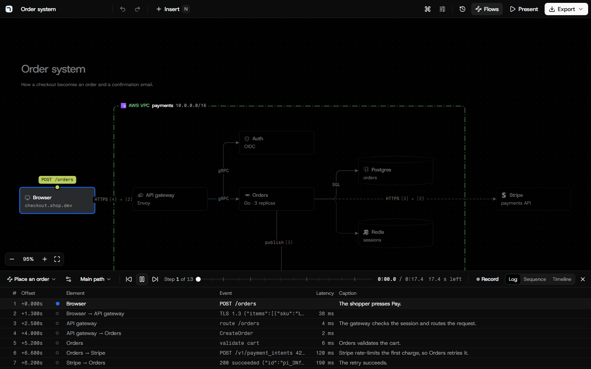

# Diagrams

[](https://scorecard.dev/viewer/?uri=github.com/math280h/diagrams)
[](https://www.bestpractices.dev/projects/16147)
[](https://github.com/math280h/diagrams/actions/workflows/ci.yml?query=branch%3Amain)

Architecture diagrams and user flows that look finished and move. Free, with no account. Your diagrams are stored
only on your computer, never on a server ([privacy](#privacy)).

**Try it at [draw.thias.dev](https://draw.thias.dev).**



## Features

<!-- features:start -->

- **Follow a request step by step.** Record the path of a request and caption each step. Play it and the camera follows. Steps can fan out and join again, branch, or go on at the same time in a side path. A flow also reads as a log or a sequence diagram.
- **Replay a real trace.** Import an OpenTelemetry, Jaeger or Zipkin trace as a flow. Each step shows the real operation, its latency and its status.
- **See where sensitive data goes.** Mark fields in request and response bodies as personal data or secrets. The Sensitive data view shows which connections carry them across a trust boundary.
- **Ask an AI agent to draw.** Claude Code and other agents draw, animate and check diagrams while you watch: in the desktop app, or in Chrome and Edge through a folder of your project. They can start from Terraform, docker-compose or Kubernetes files.
- **Export and share.** Present in full screen. Export PNG, SVG, MP4, WebM, GIF or a web page that plays the flows. Copy an image, or a link that carries the whole diagram.
- **Keep diagrams with your code.** A diagram is a JSON file that you can review and diff. A GitHub Action comments on pull requests with before and after images.

Also:

- **Templates.** Examples to play and copy, such as C4 models, RAG, an agent with MCP tools and an OpenID Connect sign-in.
- **Node kinds.** Services, data stores, queues, clients and more, each with its own outline.
- **Icons and logos.** Official AWS, Azure, Google Cloud, Kubernetes and Salesforce icons, and about 220 software logos.
- **Boundaries.** Cloud, network and cluster boundaries, or your own groups, such as a team.
- **Colours and metrics.** Colour nodes by kind or by group, and add numbers or meters.
- **Traffic on connections.** Dots, comets, dashes or pulses that flow along a connection.
- **Details on hover.** Give a node an owner, a description and links. Present shows them on hover.
- **Request and response bodies.** The JSON fields of a connection, shown in the log as a flow plays.
- **Drill-down.** A node opens another diagram, and Present zooms into it.
- **Tidy up.** Lay out the whole diagram in one go. Pinned nodes stay where you put them.
- **Walkthroughs.** Introduction and conclusion steps that show the whole path of a flow.
- **Text description.** Every diagram described in words, for screen readers and alt text.
- **Themes.** Eight themes, high contrast themes that follow your system, and theme files of your own.
- **README images.** A dark and a light image, and a snippet that shows the one for the reader's theme.
- **Mermaid.** Import and export Mermaid flowcharts, and copy a flow as a sequence diagram.
- **Version history.** Restore an earlier version. Each change an agent makes gets its own version.
- **Open in the desktop app.** Send a diagram from the website to the desktop app in one step.
- **Command-line render.** The desktop app renders diagram files to images and video for CI.
- **App on a tablet.** Install the website as an app that opens from the home screen and works offline.

<!-- features:end -->

## Privacy

Your diagrams stay on your computer. There is no account and no server that stores diagrams.

- **No server stores your diagrams.** The website keeps them in your browser (`localStorage`). The desktop app saves
  them as files in `Documents/Diagrams`.
- **Share links without an upload.** A share link carries the whole diagram.
- **Exports made on your device.** Images, videos, GIFs and web pages render in your browser or in the desktop app, not
  on a server.
- **No account.** There is nothing to sign up for.
- **No automatic error reports.** A problem report is sent only when you press Send, after you have seen its full
  text. It contains no diagram content and is encrypted for the maintainers. Crash dumps stay on your computer unless
  you attach one.<br>
  <sub>_Building it yourself? Reports are off unless you set [`DIAGRAMS_REPORT_URL`](#build-options)._</sub>

## Desktop app

The desktop app runs on Windows, macOS and Linux and keeps diagrams as files in `Documents/Diagrams`. It can also open
a diagram file anywhere, for example in `docs/` of a repository, and save it where it is, so the diagram changes in
the same commit as the code. The version history compares such a file with its last git commit. Download it
from [GitHub Releases](https://github.com/math280h/diagrams/releases/latest):

- **Windows**: `Diagrams-<version>-win-x64.exe`.
- **macOS**: the `.dmg` for `arm64` (Apple silicon) or `x64` (Intel).
- **Linux**: the `.AppImage` (make it executable first), or the `.deb`.

The installed app checks for updates, downloads them in the background and installs them when you quit or choose
Restart. "Check for updates" in the command menu checks at once.

The Windows and macOS builds are not signed yet. Windows SmartScreen asks before the first start: choose "More info",
then "Run anyway". macOS blocks the first start: open System Settings, then Privacy & Security, and choose "Open
anyway". Until the macOS build is signed, the macOS app tells you about a new version and links to it, and you install
it by hand.

The Linux packages and `SHA256SUMS` have OpenPGP signatures ([check them](SECURITY.md#openpgp-signatures)).

### Build from source

You need Node.js 24 or later and pnpm 12.16:

```sh
pnpm install
pnpm desktop:build
pnpm desktop:start
```

A build from source keeps its diagrams in `Documents/Diagrams Dev` and does not update itself. `pnpm desktop:dev`
opens the same app with hot reload, and `pnpm desktop:package` makes an installer in `release/`.

### Connect an agent

In the desktop app, choose "Connect an agent" in the library, or the agent button in the header. The dialog gives the
commands that install the Claude Code plugin with its skills, or one command that adds only the MCP server. Any other
MCP client can use the JSON in the dialog. The agent server listens on `127.0.0.1` only and needs the token from the
dialog.

### Open a diagram from the website

On the website, choose "Open in desktop app" in the export menu or in the menu of a diagram card. The browser starts
the app and hands the diagram over, and the copy in the browser stays. The app takes diagrams only from the websites
under Websites in the app settings. A build from source handles `diagrams://` links only if you start it with
`DIAGRAMS_REGISTER_PROTOCOL=1`.

### Render from the command line

The desktop app renders a diagram file to an image or a video without a window, for example to keep the images in a
README up to date:

```sh
Diagrams --render docs/orders.diagram.json --out docs/orders.png
Diagrams --render docs/orders.diagram.json --out docs/checkout.mp4 --flow "Place an order"
```

The extension of `--out` gives the format: `.png`, `.svg`, `.gif`, `.mp4` or `.webm`. `--theme <theme>` (a built-in
theme such as `dark` or `blueprint`, or a `.theme.json` file), `--flow <name or id>`, `--step <number>` (with `--flow`
and an image) and `--max-size <pixels>` change the output.
`Diagrams --render` without arguments prints the options. The command exits with 0 after it writes the file, 1 when the
render fails and 2 for a wrong command line.

- **Windows**: `& "$env:LOCALAPPDATA\Programs\Diagrams\Diagrams.exe" --render ... | Out-Default`. The pipe makes
  PowerShell wait for the app and show its output.
- **macOS**: `/Applications/Diagrams.app/Contents/MacOS/Diagrams --render ...`
- **Linux**: `diagrams --render ...` from the `.deb`, or the `.AppImage` file. Without a display, for example in CI,
  run it under `xvfb-run`.

### Keep diagram images up to date with GitHub Actions

The action `math280h/diagrams/actions/render` downloads the newest Linux release of the app and renders the diagram
files in a repository (`**/*.diagram.json`, only files that git tracks). It runs on Linux runners. Pin `@main` to a
release tag or a commit.

Redraw the images when a diagram changes on `main`. The action writes `docs/orders.png` next to
`docs/orders.diagram.json`, and the last step commits the images:

```yaml
on:
  push:
    branches: [main]
    paths: ['**/*.diagram.json']
permissions:
  contents: write
jobs:
  images:
    runs-on: ubuntu-latest
    steps:
      - uses: actions/checkout@v7
      - uses: math280h/diagrams/actions/render@main
      - run: |
          git add -- '*.png'
          git diff --cached --quiet && exit 0
          git config user.name 'github-actions[bot]'
          git config user.email '41898282+github-actions[bot]@users.noreply.github.com'
          git commit -m 'Redraw the diagram images'
          git push
```

On a pull request, the action renders each diagram that the pull request changes, as it was and as it is, and keeps
one comment on the pull request with the images side by side:

```yaml
on: pull_request
permissions:
  contents: write
  pull-requests: write
jobs:
  diagrams:
    runs-on: ubuntu-latest
    steps:
      - uses: actions/checkout@v7
      - uses: math280h/diagrams/actions/render@main
```

The images of the comments go to the branch `diagram-previews`, because GitHub shows images in a comment only from an
address. You can delete the branch at any time; the comments then lose their images. A pull request from a fork gets
no comment, because its token cannot write. Other inputs: `files`, `format` (`png` or `svg`), `theme`, `max-size`,
`mode` (`write`, `compare` or `auto`), `publish`, `preview-branch`, `version`, `app`, `base-app`, `base-root`, `screens`
and `base-screens` (see
[`actions/render/action.yml`](actions/render/action.yml)).

With `base-app`, compare mode renders the same diagrams with two builds of the app instead, for example the app of a
pull request and the app of its base commit, and the comment shows the diagrams that look different. With
`base-root`, the base app renders the base commit's own copies of the files from that folder, so a pull request that
changes the diagram format still gets old images. With `screens` and `base-screens`, it also compares two folders of
app screenshots and adds the ones that look different. This repository does both for each pull request that changes
the app (`.github/workflows/display-previews.yml`).

## Self-hosting

The website is static files with no backend. Diagrams stay in each visitor's browser or in a folder on their computer.
Diagrams from draw.thias.dev do not show in your copy, because each website has its own browser storage. Move them
with a share link, or export the diagram file and import it in the library.

### Docker

```sh
docker run -d -p 8080:8080 ghcr.io/math280h/diagrams
```

The [image](https://github.com/math280h/diagrams/pkgs/container/diagrams) runs on `linux/amd64` and `linux/arm64`. It
serves the site on port 8080, and `/health` answers while it runs. Put a proxy with HTTPS in front of it. The
[`Dockerfile`](Dockerfile) builds the same image, with the [build options](#build-options) as `--build-arg`.

### Static files

With Node.js 24 or later and pnpm 12.16, `pnpm install` and `pnpm build` write the site to `dist/`. Serve it with any
static file server:

- At the root of a host name, such as `https://diagrams.example.com/`, not in a sub-path.
- Over HTTPS. Over plain HTTP, Chrome and Edge turn off the copy buttons and "Open a folder".
- With `Cache-Control: no-cache` on `index.html` and `sw.js`. The files in `dist/assets/` have a hash in their names
  and can be cached for a year.

### Build options

Set these variables for `pnpm build` or `pnpm desktop:package`. `docker build` accepts all of them except
`DIAGRAMS_REPOSITORY_EDITABLE` and `DIAGRAMS_GITHUB_APP`.

| Variable                       | Default                  | Sets                                                                            |
| ------------------------------ | ------------------------ | ------------------------------------------------------------------------------- |
| `DIAGRAMS_WEBSITE`             | `https://draw.thias.dev` | The address of your copy, for link previews and as the first website of the app |
| `DIAGRAMS_REPOSITORY`          | `math280h/diagrams`      | The GitHub repository of the desktop releases, for downloads and updates        |
| `DIAGRAMS_REPOSITORY_EDITABLE` | off                      | With `1`, users can change the update source in the app settings                |
| `DIAGRAMS_GITHUB_APP`          | none                     | The client ID of a GitHub App, for updates from a private repository            |
| `DIAGRAMS_REPORT_URL`          | none                     | The address of your [report server](#report-server)                             |
| `DIAGRAMS_REPORT_KEYS`         | none                     | The age public keys that reports are encrypted for, separated by commas         |

Without `DIAGRAMS_REPORT_URL`, the app has no Send button. Users can still copy a report into a GitHub issue.

### Report server

You need this only if your copy should accept problem reports. It stores the encrypted reports that users send:

```sh
docker run -d -p 8080:8080 -v reports:/data \
  -e ALLOWED_ORIGINS=https://diagrams.example.com ghcr.io/math280h/diagrams-report-server
```

[`report-server/Dockerfile`](report-server/Dockerfile) builds the same image. Put a proxy with HTTPS in front of it.
`/v1/health` returns 200 while it runs. The server cannot decrypt the reports, and it does not log request bodies or
IP addresses.

| Variable                                                               | Default         | Sets                                                                       |
| ---------------------------------------------------------------------- | --------------- | -------------------------------------------------------------------------- |
| `ALLOWED_ORIGINS`                                                      | none            | Websites that may send reports, separated by commas                        |
| `STORAGE`                                                              | `fs`            | `fs` stores reports in `FS_DIR`, `s3` in an S3-compatible bucket           |
| `FS_DIR`                                                               | `/data/reports` | Folder for the reports                                                     |
| `S3_ENDPOINT`, `S3_BUCKET`, `S3_ACCESS_KEY_ID`, `S3_SECRET_ACCESS_KEY` | none            | The bucket, with `STORAGE=s3`                                              |
| `S3_REGION`                                                            | `auto`          | Region of the bucket                                                       |
| `S3_PATH_STYLE`                                                        | off             | Set to `1` for path-style URLs, which MinIO and SeaweedFS need             |
| `S3_PREFIX`                                                            | `reports/`      | Prefix of the object keys                                                  |
| `RETENTION_DAYS`                                                       | `30`            | Days before a report is deleted                                            |
| `POW_PROVIDER`                                                         | `none`          | Proof of work that clients solve before they send: `none`, `altcha`, `cap` |
| `POW_SECRET`                                                           | none            | Secret that signs the challenges, at least 32 characters                   |
| `TRUST_PROXY_HOPS`                                                     | `0`             | Number of proxies in front of the server that set `X-Forwarded-For`        |
| `REPORTS_PER_HOUR`, `CHALLENGES_PER_HOUR`                              | `20`, `60`      | Limits per client IP address (an IPv6 /64 counts as one address)           |
| `DAILY_REPORTS`, `DAILY_MEGABYTES`                                     | `2000`, `2048`  | Limits for all clients per day                                             |

Create a key pair with `age-keygen -o reports.key` and pass its public key (`age1…`) as `DIAGRAMS_REPORT_KEYS` when you
build. Keep `reports.key` off the server. To read reports, download the `.age` files from the folder or the bucket and
run `node scripts/open-report.ts --identity reports.key <files or folder>`.

### Desktop app

"Open in desktop app" works only on the websites under Websites in the app settings, and the app opens share links on
the website chosen there. Each user can add your copy. To skip that step and ship your own updates, build the app with
your address and your repository:

```sh
DIAGRAMS_WEBSITE=https://diagrams.example.com DIAGRAMS_REPOSITORY=acme/diagrams pnpm desktop:package
```

The app then updates from the releases of `acme/diagrams`. The release workflows of a fork set `DIAGRAMS_REPOSITORY`
to the fork. Without `DIAGRAMS_REPOSITORY`, the app still starts with your website, but it updates from this
repository.

For releases in a private repository, create a GitHub App in your organization with the repository permission
"Contents: Read-only" and "Enable Device Flow" on, and install it on the repository. Set its client ID as
`DIAGRAMS_GITHUB_APP`. The build checks the client ID with GitHub. The app asks users to sign in to GitHub only when
the update repository is private, and it renews the sign-in by itself.

## Development

```sh
pnpm install
pnpm dev
```

Open http://127.0.0.1:5173. [CONTRIBUTING.md](CONTRIBUTING.md) lists all commands and the checks to run before a pull
request. [docs/ARCHITECTURE.md](docs/ARCHITECTURE.md) explains how the app works, and [DESIGN.md](DESIGN.md) holds
the design system.

## Contributing

Pull requests are welcome. Read [CONTRIBUTING.md](CONTRIBUTING.md) first. Report security problems privately, as
[SECURITY.md](SECURITY.md) says.

## Licence

The code is licensed under the [MIT licence](LICENSE). The licence does not cover the icons, logos and fonts. They
belong to their owners and keep their own terms, which [THIRD-PARTY-NOTICES.md](THIRD-PARTY-NOTICES.md) lists. The
product names and logos are trademarks of their owners, and their use here does not mean that an owner endorses this
app.
