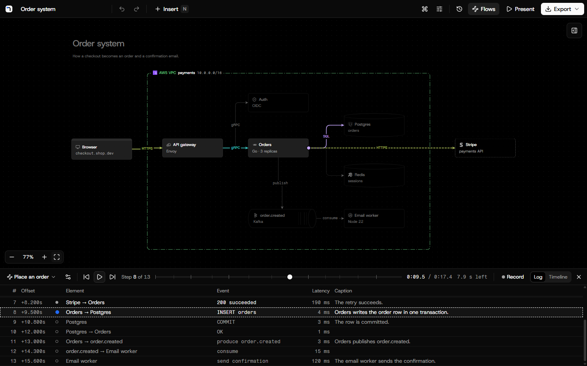

# Diagrams

Architecture diagrams and user flows that look finished and move. Free, with no account. Your diagrams stay on your
computer.

**Try it at [draw.thias.dev](https://draw.thias.dev).**



## Features

- **Node kinds with their own outlines**: services, data stores, queues, clients, external systems and functions.
  Shapes, text and boundaries for AWS, Azure, Google Cloud, Kubernetes and custom groupings, coloured by kind or in
  one colour. Metrics and meters are optional.
- **Real icons**: the official AWS, Azure, Google Cloud and Kubernetes architecture icons, and 220 software logos.
  Search them in the insert menu or the icon picker.
- **Moving connections**: dots, comets, dashes or pulses that flow along a connection. Turn them on for one
  connection or for all.
- **Flows**: record a path through the diagram, add captions, and play it back with a camera that follows the user.
  A timeline adds camera paths and fades.
- **Present and export**: present in full screen, or export PNG, SVG, MP4, WebM or GIF. Video export is exact to the
  frame.
- **Mermaid import**: paste a Mermaid flowchart and get a laid-out diagram.
- **Version history**: see how a diagram looked earlier, including each change that an agent made, and restore any
  version.
- **Local first**: the website keeps diagrams in your browser. Export a diagram file (JSON) to move it to another
  browser.
- **Desktop app and AI agents**: the desktop app keeps diagrams as files, and AI agents such as Claude Code can draw,
  animate and render diagrams in it while you watch.

## Desktop app

The desktop app runs on Windows, macOS and Linux and keeps diagrams as files in `Documents/Diagrams`. Download it
from [GitHub Releases](https://github.com/math280h/diagrams/releases/latest):

- **Windows**: `Diagrams-<version>-win-x64.exe`.
- **macOS**: the `.dmg` for `arm64` (Apple silicon) or `x64` (Intel).
- **Linux**: the `.AppImage` (make it executable first), or the `.deb`.

The installed app checks for updates, downloads them in the background and installs them when you quit or choose
Restart. "Check for updates" in the command menu checks at once.

The builds are not signed yet. Windows SmartScreen asks before the first start: choose "More info", then "Run
anyway". macOS blocks the first start: open System Settings, then Privacy & Security, and choose "Open anyway". Until
the macOS build is signed, the macOS app tells you about a new version and links to it, and you install it by hand.

### Build from source

You need Node.js 24 or later and pnpm 10.33:

```sh
pnpm install
pnpm desktop:build
pnpm desktop:start
```

A build from source keeps its diagrams in `Documents/Diagrams Dev` and does not update itself. `pnpm desktop:dev`
opens the same app with hot reload, and `pnpm desktop:package` makes an installer in `release/`.

### Connect an agent

In the desktop app, choose "Connect an agent" in the library, or the agent button in the header. The dialog gives the
commands that install the Claude Code plugin with its skills, or one command that adds only the MCP server. Any other
MCP client can use the JSON in the dialog. The agent server listens on `127.0.0.1` only and needs the token from the
dialog.

### Open a diagram from the website

On the website, choose "Open in desktop app" in the export menu or in the menu of a diagram card. The browser starts
the app and hands the diagram over, and the copy in the browser stays. A build from source handles `diagrams://` links
only if you start it with `DIAGRAMS_REGISTER_PROTOCOL=1`.

## Development

```sh
pnpm install
pnpm dev
```

Open http://127.0.0.1:5173. [CONTRIBUTING.md](CONTRIBUTING.md) lists all commands and the checks to run before a pull
request. [docs/ARCHITECTURE.md](docs/ARCHITECTURE.md) explains how the app works, and [DESIGN.md](DESIGN.md) holds
the design system.

## Contributing

Pull requests are welcome. Read [CONTRIBUTING.md](CONTRIBUTING.md) first. Report security problems privately, as
[SECURITY.md](SECURITY.md) says.

## Licence

The code is licensed under the [MIT licence](LICENSE). The licence does not cover the icons, logos and fonts. They
belong to their owners and keep their own terms, which [THIRD-PARTY-NOTICES.md](THIRD-PARTY-NOTICES.md) lists. The
product names and logos are trademarks of their owners, and their use here does not mean that an owner endorses this
app.
